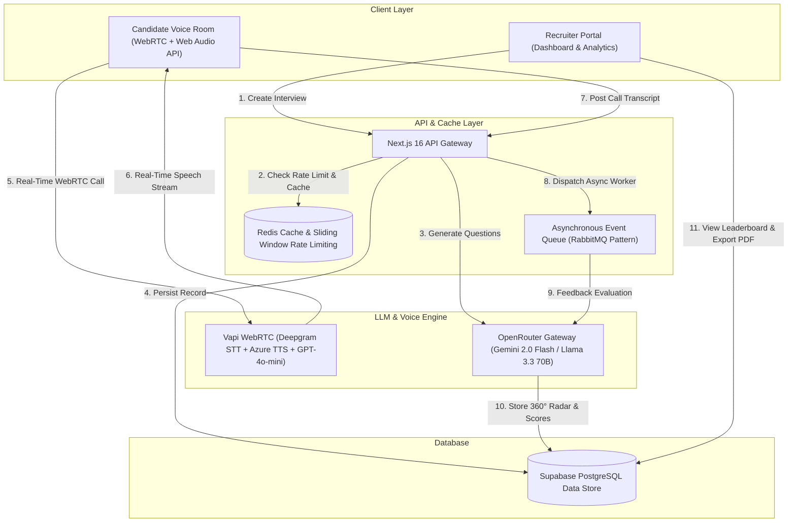

<div align="center">


# 🎙️ VOX HIRE — Enterprise AI Recruiter Voice Agent

**Autonomous, real-time voice AI screening platform powered by WebRTC, Next.js 16, Redis, and LLM Feedback Synthesis.**

[](https://vox-hire-voice-agent.vercel.app)
[](https://github.com/h1a2r3s4h/VoxHire---Voice-agent)
[](https://nextjs.org/)
[](https://www.typescriptlang.org/)
[](https://supabase.com/)
[](https://redis.io/)
[](https://www.docker.com/)

---

*VOX HIRE conducts 2-way real-time voice interviews autonomously, evaluates technical & behavioral competency, dynamic deep-dive probes, and ranks top applicants automatically.*

</div>

---

## 🏗️ System Architecture & Workflow



---

## 📸 Core Screenshots & Interface Features

| Interface | Highlights |
| :--- | :--- |
| 🏠 **Landing Page** | Pitch Black (`#000000`) + Electric Indigo (`#6366f1`) design system, Google Plus Jakarta Sans typography. |
| 🎙️ **Live Candidate Room** | HTML5 Canvas **Audio Waveform Visualizer**, live timer, microphone permission pre-flight checks. |
| 🧠 **AI Assessment & PDF Export** | **360° Competency Radar Matrix**, skill ratings out of 10, executive summary, 1-click **Export PDF Report** (`jsPDF`). |
| 🏆 **Candidate Leaderboard** | Recruiter candidate ranking table with **#1 Trophy** rank badge, technical scores, and recommendation status. |

---

## ✨ Enterprise Feature Matrix

| Feature | Description | Technical Implementation |
| :--- | :--- | :--- |
| 🗣️ **Real-Time Voice AI** | Low-latency 2-way WebRTC interactive voice screening call. | `Vapi WebRTC` + `Deepgram STT` + `Azure TTS` + `GPT-4o-mini` |
| 🌊 **Live Audio Waveform** | Animated frequency spectrum canvas responding to voice streams in real-time. | Browser `Web Audio API` (`AnalyserNode` + `AudioContext`) |
| 🎯 **Dynamic Deep-Dive Probing** | AI Recruiter asks concise technical follow-up probes when candidates give surface answers. | Custom System Prompt Engineering |
| 📊 **360° Competency Radar** | Visual 5-axis pentagon rating Technical Depth, Problem Solving, Clarity, Confidence, and Role Fit. | Custom SVG Pentagon Component (`CompetencyRadar.tsx`) |
| 🏆 **Candidate Leaderboard** | Ranks all applicants for a position by average rating score with #1 Trophy badges. | Relational queries & frontend score sorting |
| 📄 **1-Click PDF Report Export** | Instant client-side download of formatted evaluation reports. | Vector document rendering via `jsPDF` |
| 🔴 **Redis Rate Limiting & Cache** | Sliding window rate limiting (10 req/min per IP) and 1-hour LLM response caching. | In-memory & Redis Key-Value Store (`lib/redis.ts`) |
| 🐇 **Async Event Queue** | Decoupled background processing for LLM evaluation and notification tasks. | Event-Driven Queue Publisher/Subscriber (`lib/eventQueue.ts`) |

---

## 🛠️ Tech Stack & Dependencies

- **Frontend & App Framework**: Next.js 16 (Turbopack), React 19, TypeScript
- **Styling & Components**: Vanilla CSS + Tailwind CSS v4, Lucide Icons, `shadcn/ui`, `sonner` Toasts
- **Voice & Media Engine**: Vapi WebRTC Client SDK, Deepgram STT, Azure TTS, Web Audio API
- **AI & LLM Services**: OpenAI Client SDK, OpenRouter Gateway (Google Gemini 2.0 Flash & Meta Llama 3.3 70B)
- **Database & Authentication**: Supabase (PostgreSQL), Google OAuth
- **Caching & Queue Architecture**: Redis Sliding Window Rate Limiter & Async Event Queue
- **Export & Testing**: `jsPDF`, `html2canvas`, Vitest test suite

---

## ⚙️ Installation & Setup

### 1️⃣ Clone the Repository

```bash
git clone https://github.com/h1a2r3s4h/VoxHire---Voice-agent.git
cd VoxHire---Voice-agent
```

### 2️⃣ Install Dependencies

```bash
npm install
```

### 3️⃣ Configure Environment Variables

Create a `.env.local` file in the root directory:

```env
NEXT_PUBLIC_SUPABASE_URL=https://your-supabase-project.supabase.co
NEXT_PUBLIC_SUPABASE_ANON_KEY=your_supabase_anon_key
OPENROUTER_API_KEY=your_openrouter_api_key
NEXT_PUBLIC_HOST_URL=http://localhost:3000
NEXT_PUBLIC_VAPI_API_KEY=your_vapi_public_api_key
```

### 4️⃣ Run Development Server & Tests

```bash
# Run Vitest Automated Test Suite
npm test

# Check TypeScript Type Safety
npx tsc --noEmit

# Start Next.js Development Server
npm run dev
```

Open `http://localhost:3000` in your browser.

---

## 🐳 Docker Deployment Setup

The project includes an optimized multi-stage `Dockerfile` with Next.js standalone output.

```bash
# Build Docker Image
docker build -t voxhire-agent .

# Run Container
docker run -p 3000:3000 --env-file .env.local voxhire-agent
```

---

## 👨‍💻 Author & Maintainer

<div align="center">

**Harshit Gangwar**

*Architect & Full-Stack Engineer*

[](https://github.com/h1a2r3s4h)

---

⭐ **If you find VoxHire useful, please give it a star on [GitHub](https://github.com/h1a2r3s4h/VoxHire---Voice-agent)!**

</div>